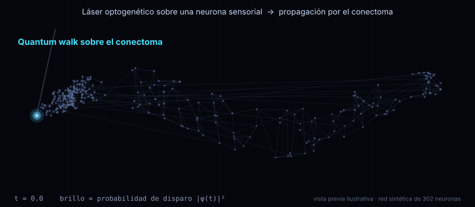

# Cerebro Cuántico Optogenético

Visualización 3D del conectoma de *C. elegans*. Un "láser optogenético" ilumina una neurona y una **quantum walk** propaga la actividad por la red. Además, un microcircuito del reflejo de toque corre en hardware cuántico real de IBM.



*Vista previa ilustrativa con una red sintética de 302 neuronas.*

La idea completa, con diagramas, está en `Cerebro Cuántico Optogenético.docx`.

---

## Metodología de trabajo: 4 personas, viernes a domingo

### Principios

1. **Primero el MVP.** El MVP es la quantum walk sobre el conectoma, con un gusano 3D y clic para iluminar. Nada se agrega encima hasta que eso funcione de punta a punta.
2. **Integrar temprano y seguido.** Cada pieza se conecta con las demás desde el viernes, aunque sea con datos falsos.
3. **Siempre hay algo que mostrar.** Al cierre de cada día, `main` tiene una demo que funciona.
4. **Timeboxes estrictos.** Si algo se traba más de 45 minutos, se pide ayuda o se cambia de enfoque.

### Roles

Cada rol tiene dueño, pero todos pueden ayudar en los demás.

| Persona | Rol | Es dueña de | Entregable mínimo |
| --- | --- | --- | --- |
| **P1** | Física / quantum walk | Cargar el conectoma, armar la matriz A, calcular P_k(t) = \|⟨k\|e^{-iγAt}\|j⟩\|² | Función `probabilidades(neurona, t)` → arreglo de 302 valores |
| **P2** | Circuito y hardware | Microcircuito del reflejo de toque en Qiskit: pulso → RX(θ), sinapsis → CRY(φ). Correrlo en IBM | Histograma de patrones de disparo guardado en JSON |
| **P3** | Frontend 3D | Escena en three.js: gusano, neuronas, clic-láser, sliders, animación | Escena que anima un arreglo de 302 brillos |
| **P4** | Integración y presentación | Backend FastAPI que une P1 y P2 con P3. Repositorio, narrativa, slides y video de respaldo | API funcionando y demo ensayada |

P4 también hace de *facilitador*: lleva el tiempo, corre los check-ins y decide cuándo se congela el código.

### Contrato entre piezas (definir el viernes en la primera hora)

```
GET  /conectoma            -> { "neuronas": [{id, nombre, x, y, z}], "aristas": [[i, j, peso]] }
POST /quantum-walk         <- { "neurona": j, "theta": θ, "t_max": T, "pasos": N }
                           -> { "tiempos": [...], "prob": [[302 valores], ...] }
GET  /microcircuito        -> { "neuronas": [ids], "shots": {"0101": 312, ...}, "backend": "ibm_..." }
```

Con este contrato fijo, P3 puede trabajar con datos falsos desde la primera hora sin esperar a P1 ni a P2.

### Estructura del repositorio

```
cerebro-cuantico/
├── backend/        # FastAPI (P4)
├── fisica/         # quantum walk, carga del conectoma (P1)
├── circuito/       # Qiskit + resultados de IBM en JSON (P2)
├── frontend/       # three.js (P3)
├── datos/          # conectoma limpio (CSV/JSON)
└── presentacion/   # slides, video de respaldo, guion (P4)
```

---

## Plan por día

### Viernes: base y esqueleto conectado

| Bloque | Qué se hace | Quién |
| --- | --- | --- |
| Kickoff (1 h) | Leer la idea juntos, confirmar roles, escribir el contrato de la API, crear el repo | Todos |
| Bloque 1 (3 h) | P1: descargar y limpiar el conectoma (OpenWorm / WormWiring), simetrizar A · P2: microcircuito en simulador · P3: gusano 3D con datos falsos · P4: esqueleto FastAPI con endpoints de mentira | Cada uno en lo suyo |
| Check-in (15 min) | ¿Qué funciona? ¿Qué bloquea? | Todos |
| Bloque 2 (3 h) | P1: quantum walk real expuesta en la API · P3: conectar la escena a la API · P2: primera corrida en IBM (la cola puede tardar) · P4: integrar y ayudar donde haya bloqueo | Cada uno en lo suyo |
| Cierre (30 min) | **Hito 1:** clic en una neurona → el gusano se ilumina con datos reales de la quantum walk | Todos |

### Sábado: MVP sólido y el hardware real

| Bloque | Qué se hace | Quién |
| --- | --- | --- |
| Stand-up (15 min) | Revisar el hito 1 y priorizar el día | Todos |
| Bloque 1 (3,5 h) | P1: ajustar γ y t para que la propagación se vea bien, y mapear θ → estado inicial · P3: glow, colores, cámara, slider de intensidad · P2: resultados de IBM en JSON, conectados a la API · P4: guion de la demo | Cada uno en lo suyo |
| Check-in (15 min) | Probar la demo completa una vez | Todos |
| Bloque 2 (3,5 h) | P3 + P2: animar las ráfagas de spikes del microcircuito sobre el gusano · P1: sección de física para las slides · P4: slides y grabar un video de respaldo preliminar | Pares |
| Cierre (30 min) | **Hito 2:** demo completa de punta a punta. **Congelar funcionalidades:** desde aquí no se agrega nada nuevo | Todos |

### Domingo: pulir, ensayar y entregar

| Bloque | Qué se hace | Quién |
| --- | --- | --- |
| Stand-up (15 min) | Lista de bugs y detalles visuales, en orden de prioridad | Todos |
| Bloque 1 (3 h) | Solo corregir bugs y pulir lo visual. Probar en el computador que se usará para presentar | P1, P2, P3 |
| Bloque 1 (3 h) | Cerrar slides, grabar el video final de respaldo, README del repo | P4 |
| Ensayo (1 h) | Al menos 2 ensayos completos con cronómetro. Todos deben poder explicar la analogía luz → qubit → neurona | Todos |
| Entrega | Subir el repo, el video y las slides | P4 |

> Si la entrega es el domingo temprano, el bloque de pulido se acorta y el ensayo pasa a ser lo primero del día.

---

## Rituales y reglas del equipo

- **Check-ins cortos (15 min)** tras cada bloque: qué hice, qué sigue y qué me bloquea.
- **Git:** una rama por persona (`fisica`, `circuito`, `frontend`, `backend`), merge a `main` al menos dos veces al día y siempre antes del cierre. Nada roto en `main`.
- **Tablero de tareas:** tres columnas (Por hacer, En curso, Listo) en el canal del grupo o en un tablero compartido. Cada tarea tiene un dueño.
- **Plan B siempre listo:** resultados de IBM precalculados, un video de la demo y la escena capaz de funcionar sin backend con datos guardados.
- **Descansos:** comer lejos del computador. Un equipo cansado introduce bugs el domingo.

## Definición de "listo"

Una tarea está lista cuando:

1. funciona integrada en `main`, no solo en la rama propia,
2. otra persona del equipo la probó, y
3. se puede explicar en una frase durante la presentación.

## Lista de extras (solo si sobra tiempo después del hito 2)

- [ ] Sonido para cada spike
- [ ] Mostrar la ecuación en pantalla mientras se anima
- [ ] Segundo organismo (larva de *Drosophila*)
